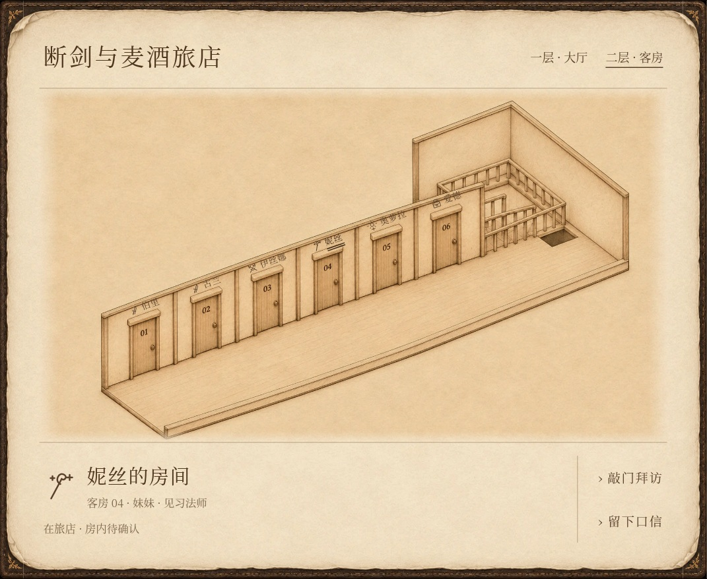

# 断剑与麦酒旅店 · 一排六间客房

[一层手札](../../接入验证/inn-ground.jpg) · [手机手札](../../接入验证/inn-mobile.jpg)

[玩家房间](player-room-preview.jpg) · [手机效果](mobile-rooms-preview.jpg) · [六门底图](upper-scene.jpg) · [行动填入效果](interaction-preview.jpg) · [下载正式 HUD 预览](../../接入验证/hud-live-preview.html)

## 房间

同一侧走廊的一排六个房间，从左到右：

| 图面编号 | 入住角色 | 身份 |
| --- | --- | --- |
| 01 | 伯里 | 玩家，见习战士 |
| 02 | 古兰 | 伯里与妮丝的母亲，独立住客 |
| 03 | 伊丝娜 | 猫耳斥候 |
| 04 | 妮丝 | 伯里的妹妹，见习法师 |
| 05 | 奥萝拉 | 见习牧师 |
| 06 | 爱德 | 随行后勤 |

古兰不是领队或冒险者小队成员；独立住客仍有住宿与访问入口。图面房号用于导览，不自动改写角色卡存档。实际是否在房和爱德是否已经加入，服从当前游戏状态；截图来自独立沙盒存档。

## 交互

一层大厅与二层客房分别切换。点房门只展开人物和房间，再选择行动填入输入框。保留已有草稿，不自动发送。

玩家房间提供回房休息、整理行囊。其他住客在房时可拜访或交谈，外出时显示已知去向并可寻找、留言；未知状态先敲门确认。地图不把同住旅店视为同在卧室，也不代替原有夜间同住规则。

姓名与单色线描职业图标缩小后放在各自门楣上，并随墙面倾角排列。桌面可直接点木门；手机保留门楣小标注，并使用图下至少 44px 的姓名入口。图标与姓名独立于底图，未知住客显示通用房号。

皮革装订纸页采用九宫格切片，房间状态、行动与草稿可随内容向下伸展，建筑图稿保持原比例。图标为内联 SVG，不再使用金属徽章图集。

## 正式状态栏接入

[使用正式 HUD 的可交互沙盒预览](../../接入验证/hud-live-preview.html) · [接入说明](../../接入验证) · [自动启动脚本](../../../dist/okh_complete_autostart.js?raw=1)

地图现已进入正式渲染链路，读取当前聊天存档。人在旅店显示“房内待确认”，不沿用旧示例的在房判断。房门选择和行动意图不会直接改变游戏状态。

- `ground-scene.jpg/webp`、`upper-scene.jpg/webp`：两层图稿。
- `rooms-preview.jpg`、`mobile-rooms-preview.jpg`、`player-room-preview.jpg`、`interaction-preview.jpg`：当前正式 HUD 的沙盒截图。
- `geometry-reference.py`：六门结构参考。

旧独立房间组件与演示 HTML 已被正式 HUD 接入替代。图面六房分配来自用户要求；实际是否登场、在店、活动或同住从存档读取。

