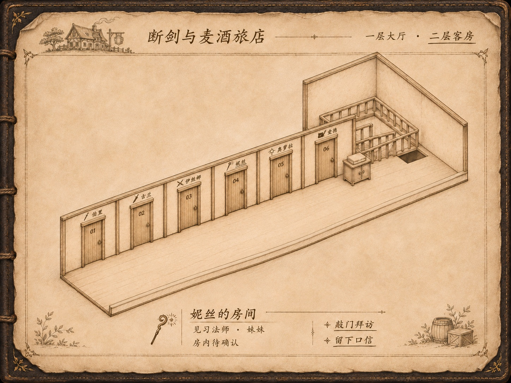
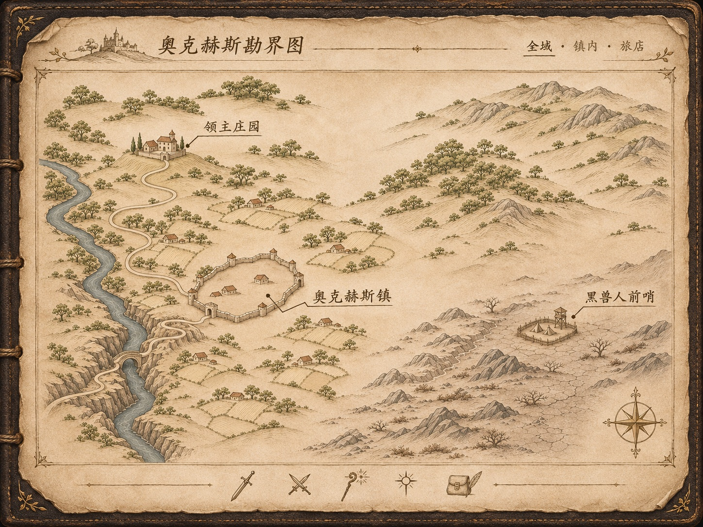

# 地图界面 · 整体美术方向

[全域界面](整体效果.jpg) · [旅店二层界面](旅店二层.jpg)

## 旅店二层

同一侧走廊、一排六扇门，按伯里、古兰、伊丝娜、妮丝、奥萝拉、爱德排列。古兰为独立住客，不标为领队或小队成员。

本稿演示选中妮丝：六个姓名与职业符号缩小为门楣上方的紧凑小标注，走廊地面留空；纸面下方展开房间信息、“房内待确认”与敲门、留言入口。职业符号、姓名、楼层题签和人物批注使用同一套墨绘笔触，不用金属徽章或网页卡片。

## 全域界面

统一地图、题注、职业符号、边饰与界面材料。保留已确认地理：西北山上庄园、东北树林、环镇农耕、河谷险道、东南恶劣荒地的敌对前哨；前哨不接人类道路。

旅店方向现已接入正式运行脚本：[可交互实现截图](../接入验证/inn-upper.jpg) · [手机实现](../接入验证/inn-mobile.jpg) · [运行预览](../接入验证/hud-live-preview.html)。实际页面使用独立的纸页边框、无字底图与动态姓名 / SVG 职业符号；住客状态和行动读取当前存档。上方图片仍保留为获认可的美术方向参考，全域完整效果稿尚未逐项落地。

图稿由 AI 生成，用于整体美术审阅。

