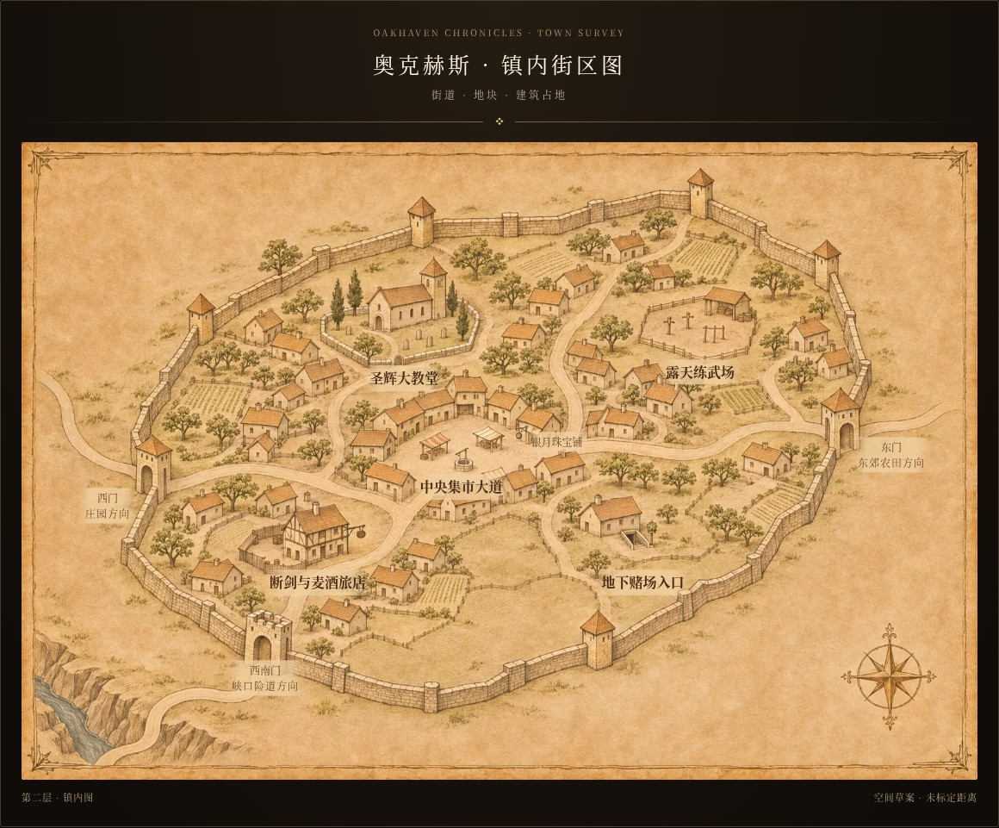

# 第二层：奥克赫斯镇内街区图

[查看无文字底图](town-art.webp) · [下载独立预览](preview.html) · [返回第一层：全域图](../全域图)

## 本层内容

本图沿用全域图的城镇朝向、总体城墙轮廓及西门、西南门、东门的关系，在此基础上展开主街、支巷、建筑地块和出入口。

- 圣辉大教堂与相关庭院：北侧街区。
- 露天练武场：东北侧小型训练院落。
- 中央集市大道：主街交汇处的市集与周边店铺。
- 断剑与麦酒旅店：西南街区，带小院落。
- 地下赌场入口：东南街区，只显示地面建筑与入口，不展开地下室。
- 银月珠宝铺：沿用现有状态栏的场景名称，标注在集市周边，不另加后台地点 ID。

## 与全域图的对应

- 西门：通往西北庄园方向的人类道路。
- 西南门：衔接峡口、窄桥与险道的进镇主路。
- 东门：面向东郊农田，不通往敌对兽人营地。
- 领主庄园位于镇外西北山上，因此不作为本图中的建筑绘制。

建筑通过轮廓和占地辨认，保留院落、菜圃、空地和未标注地块；不把既有地点放大成占满画面的图标。相对大小、具体街区安排及建筑入口均为空间草案，不是已测量的正式设定，不标数字比例尺。

## 文件

- `map-preview.jpg`：有地名的预览截图，GitHub 可直接显示。
- `town-art.webp`：无文字底图。
- `preview.html`：图片内嵌的独立预览，下载一个文件即可打开。
- `map-source.html`：可编辑的原始页面，图片相对路径为 `town-art.webp`。

[第三层：断剑与麦酒旅店导览](../室内图/断剑与麦酒旅店) 采用单层斜俯视与切层，二层为同一排六间客房，提供房门点选与角色交互。教堂、赌场等室内图待绘制。

底图由 AI 生成，地名独立叠加。当前为第二层图稿，尚未连接酒馆后台；旅店精确占地需与最终确认容量进一步统一。
