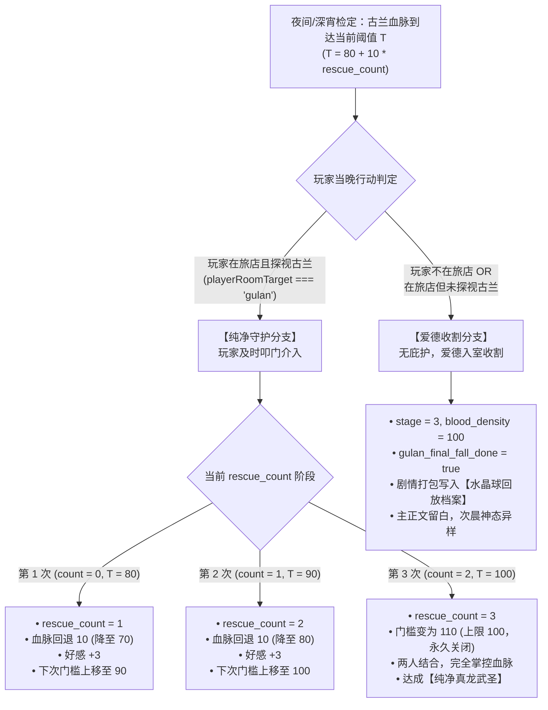

# 设定 · 古兰三段式阶梯守护与水晶球回放机制定稿

> **定稿时间**：2026-11-24 08:45 (UTC+8)  
> **文档性质**：古兰终局 Checkpoint 3 守护机制与水晶球回放系统工程设计定稿文档  
> **真源位置**：`奥森德/src/app/okh_app_data.js`（对应 `gulan_final_rescue_prompt` / `gulan_final_fall_dark` 重构）  
> **文风与执行红线**：恪守《GEMINI.md》与《写作指导.md》，封杀 13 项受限词，零代打留白，爱德收割情节合规处理（显现成年太古黑龙法相威仪，严禁孩童外貌与亲密行为挂钩）。

---

## 一、 核心痛点与架构解决方案

### 1. 旧逻辑逻辑死锁归因
* **旧代码倒错**：原 `gulan_final_fall_dark` 判定中包含 `Boolean(npc.flags?.gulan_rescued_final)`，导致玩家好感度高且在危机中成功救助古兰一次后，血脉到达 90 反而必然判定爱德收割堕落。
* **视角割裂问题**：旧设计未考虑玩家身在异地或夜间未探视的情境，强行在主正文中突兀插播非玩家视角的第三人称长文，破坏叙事沉浸感。

### 2. 水晶球回放系统（Crystal Ball Playback System）
* **玩家在场介入**：触发当面危机交互，玩家以陪伴和心智引导协助古兰压制暴动，打上纯净守护进度；
* **玩家缺席/未介入**：
  * **主正文完全留白（零剧透）**：玩家正常度过当夜，次日清晨仅通过古兰神态细节的异样（裙摆遮掩、步履微滞、琥珀竖瞳躲闪目光）感知变故；
  * **后台静默推进**：NPC 状态直接流转至 `stage = 3`，`blood_density = 100`，`gulan_final_fall_done = true`；
  * **写入水晶球回放队列**：将爱德撕开伪装、道破生父真相、权杖引动真血并全面占有的高张力剧情打包存入 `world.crystalBall.records`，供玩家后续通过水晶球道具随时窥视回放。

---

## 二、 三段式阶梯守护机制（数学模型与判定契约）

引入独立守护计数器 `gulan_rescue_count`（初始值为 0）。

$$\text{触发阈值 } T = 80 + 10 \times \text{rescue\_count}$$

### 1. 阶段推进明细表

| 轮次 | 门槛条件 | 玩家守护成功结果 | 玩家缺席/未介入结果 |
| :---: | :---: | :--- | :--- |
| **第 1 次** | 血脉 $\ge 80$，夜间旅店 | `rescue_count = 1`；血脉回退至 70；好感 $+3$；下次门槛上移至 90。 | 爱德入室收割；`stage = 3`；血脉拉满 100；剧情入水晶球回放 1 号。 |
| **第 2 次** | 血脉 $\ge 90$，夜间旅店 | `rescue_count = 2`；血脉回退至 80；好感 $+3$；下次门槛上移至 100。 | 爱德入室收割；`stage = 3`；血脉拉满 100；剧情入水晶球回放 2 号。 |
| **第 3 次** | 血脉 $\ge 100$，夜间旅店 | `rescue_count = 3`；门槛升至 110（血脉上限 100，**数学闭环永久封死爱德收割路径**）；灵肉交融身心缔约；血脉固定 100，达成纯净觉醒。 | 爱德入室收割；`stage = 3`；血脉拉满 100；剧情入水晶球回放 3 号。 |

---

## 三、 三次守护剧情分镜与心智演进

恪守文字白描原则，严禁极端词汇与霸总修辞：

### 1. 第一次（80 血脉 · 压制与自持）
* **破绽**：房内传来长剑坠地的沉闷撞击声与不规律的沉重吐息。
* **微观表征**：古兰单膝支地按住桌面，黑底长裙领口被热汗浸透，太阳穴两侧乌黑龙角的根部泛起暗红异热。
* **心智交锋**：强撑身为长辈与前卫战士的体面，谎称仅是白日挥剑过量；但紧抓桌角发颤的指尖暴露出体内真血的翻腾。
* **应对**：玩家近身递水安抚其角根与颈项，古兰偏头避开目光，耳根泛红，在羞涩与警惕中平息躁动。

### 2. 第二次（90 血脉 · 心防裂缝与真实依赖）
* **破绽**：客房门缝透出狂暴的灼热气流，房内传来压抑的低泣与被褥撕扯声。
* **微观表征**：古兰蜷缩在床榻边缘，十指深陷入枕褥，冷汗浸透额前碎发，琥珀色竖瞳涣散。
* **心智交锋**：太古黑龙的梦魇低语令其认知模糊。理智本能地推拒来人以免伤及同伴，但在指尖碰到玩家手腕的瞬间，五指却不由自主地死死攥住对方衣襟。
* **应对**：玩家拥其入怀贴身守护，在温和陪伴中化解梦魇。古兰额头贴在玩家胸膛，沉沉睡去。

### 3. 第三次（100 血脉 · 水到渠成 · 身心缔约）
* **破局之道**：真血全面沸腾，外力安抚已无法压制始祖龙力的反噬。退一步是人性沦丧，唯有以炽烈真挚的情感为基石，身心相融方能驯服这股太古伟力。
* **微观表征**：古兰双颊泛着酡红，龙角尖端暗红流转。她卸下多年以来的自立面具，主动倾诉对玩家的依恋与信任。
* **交融**：两人完成水到渠成的灵肉交融。在亲密无间的温度中，古兰以坚毅意志为舟、以深厚羁绊为锚，将暴虐的真龙血脉驯服为自身掌控的纯净力量，迈入 V 阶传奇超凡门槛。

---

## 四、 爱德收割线与合规风控红线

1. **外观形态合规红线**：
   收割发生时，爱德必须明确**褪去瘦弱孩童伪装，显现出太古黑龙成年法相或庞大龙躯暗影**，行使上位古龙的威权与血脉同化，严禁使用孩童外表描写亲密行为；
2. **剧本结构要点**：
   * 现身坦白：爱德缓步入室，不再掩饰古龙威压，挑明其太古黑龙生父身份；
   * 伪装揭晓：道出泥足期以来的夜间潜入真相（古兰以为的春梦实为爱德暗中引渡龙煞催熟真血）；
   * 权杖引爆：拔出伪装成小木剑的古龙权杖，全面唤醒始祖真血，古兰在血脉本能的反扑中无力抵抗，身心被黑龙契约烙印；
3. **水晶球呈现**：
   当玩家未履行守护时，上述文本自动写入 `world.crystalBall.records`，作为历史留影供玩家后续检视。
