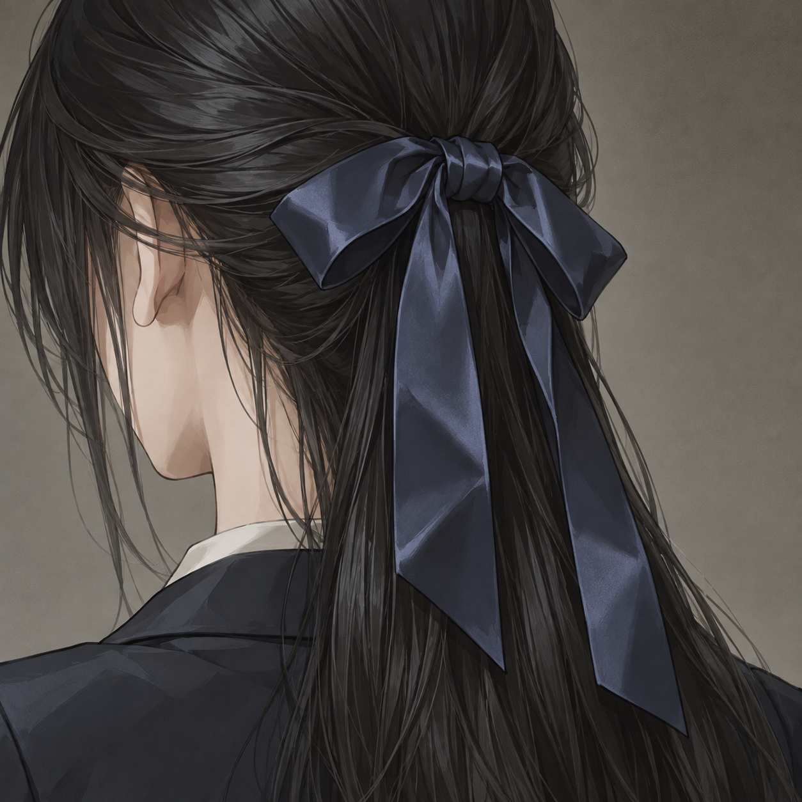
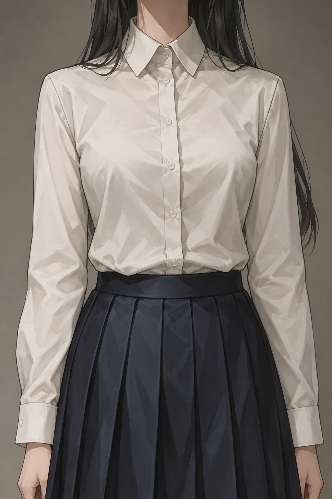
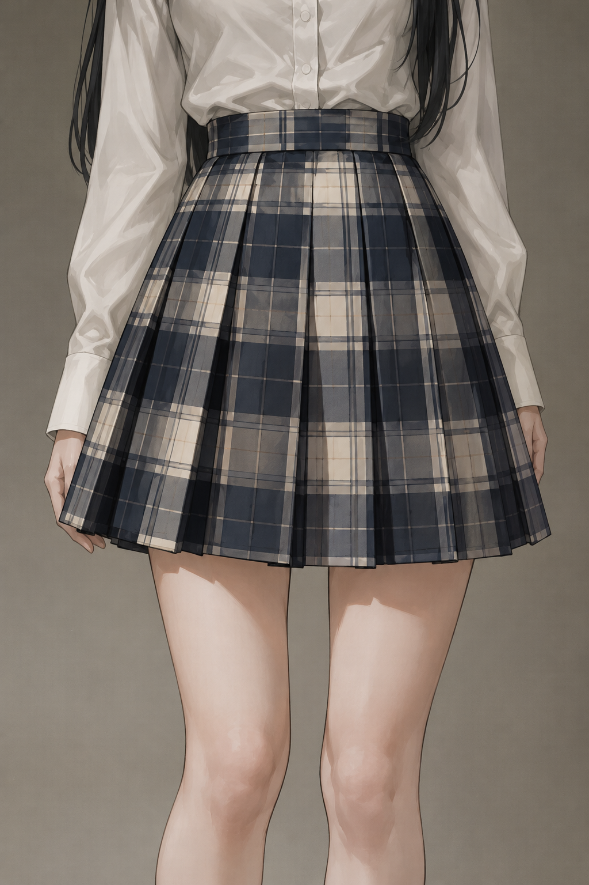
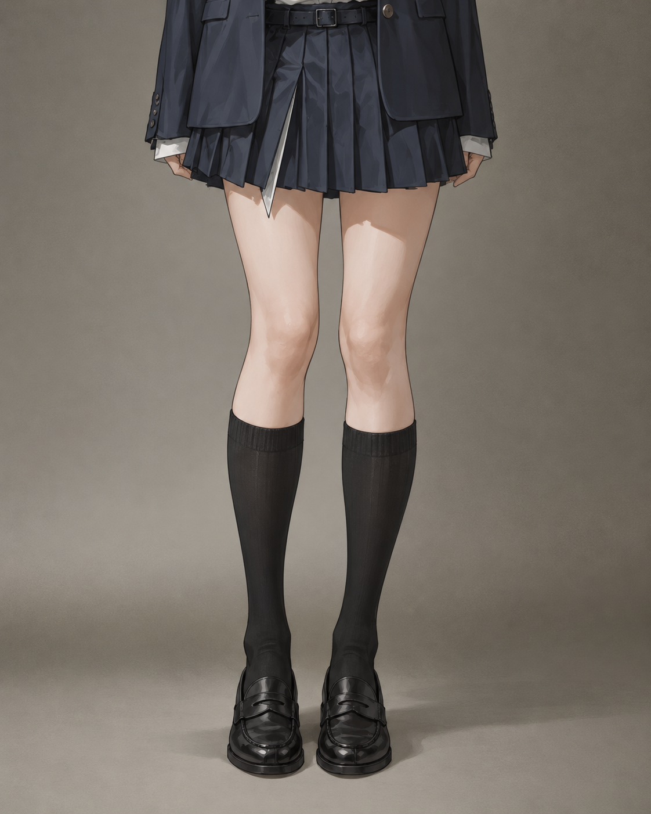
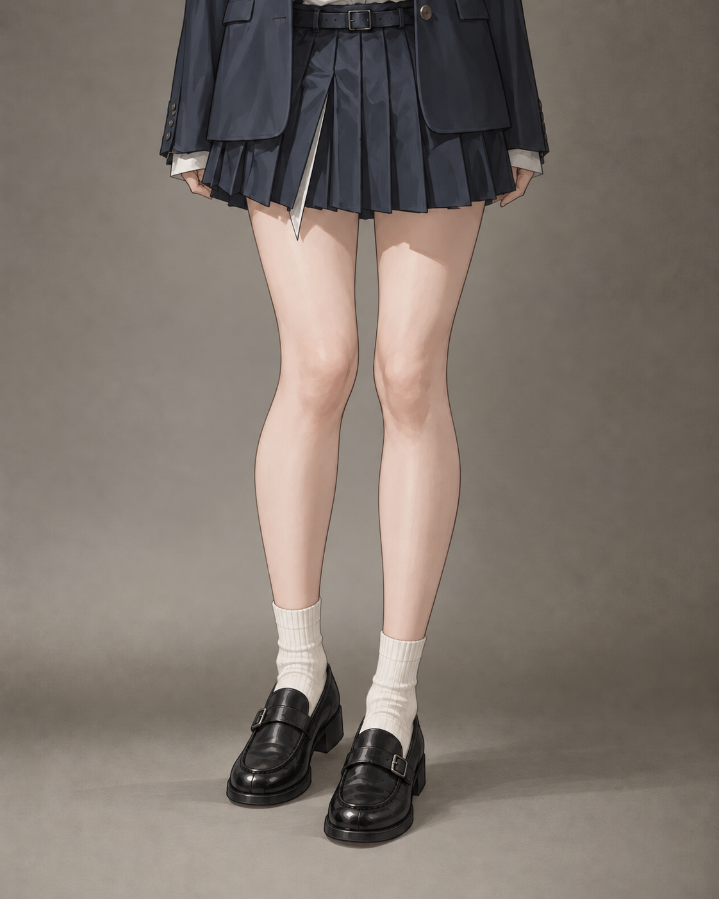

# 服装特写例图 · 灰调厚涂版

依据本次提供的参考图重新生成：低饱和灰调、日系厚涂、柔和阴影与布料褶皱。五类各一张。

[上一版写实例图](../wardrobe-samples/)

## 藏青发带

[查看原图](head_ribbon_navy-side.png)

## 白衬衫

[查看原图](top_jk_shirt-front.png)

## 格纹百褶裙

[查看原图](bottom_jk_pleat_plaid-front.png)

## 黑色及膝袜

[查看原图](sock_knee_black-front.png)

## 制服小皮鞋

[查看原图](shoe_leather-three-quarter.png)
