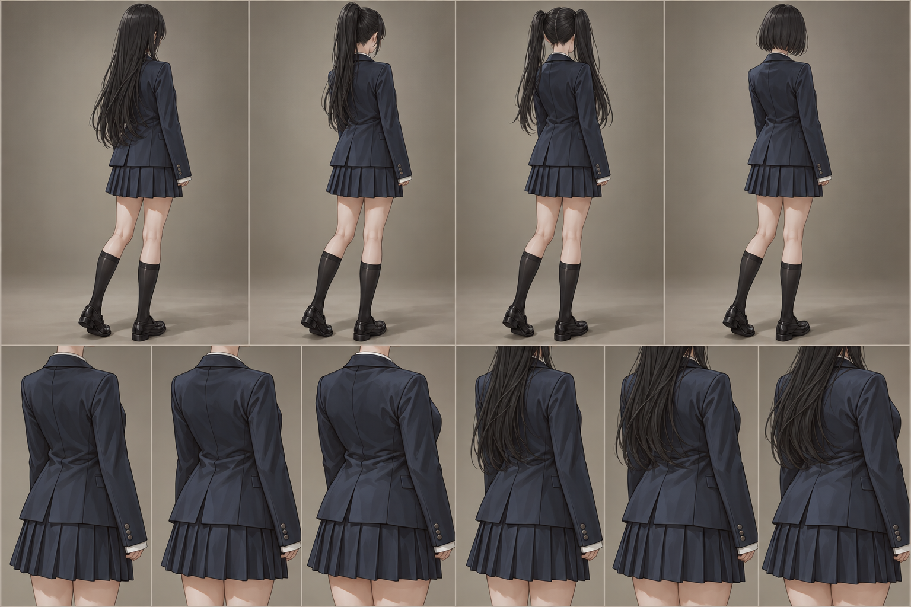
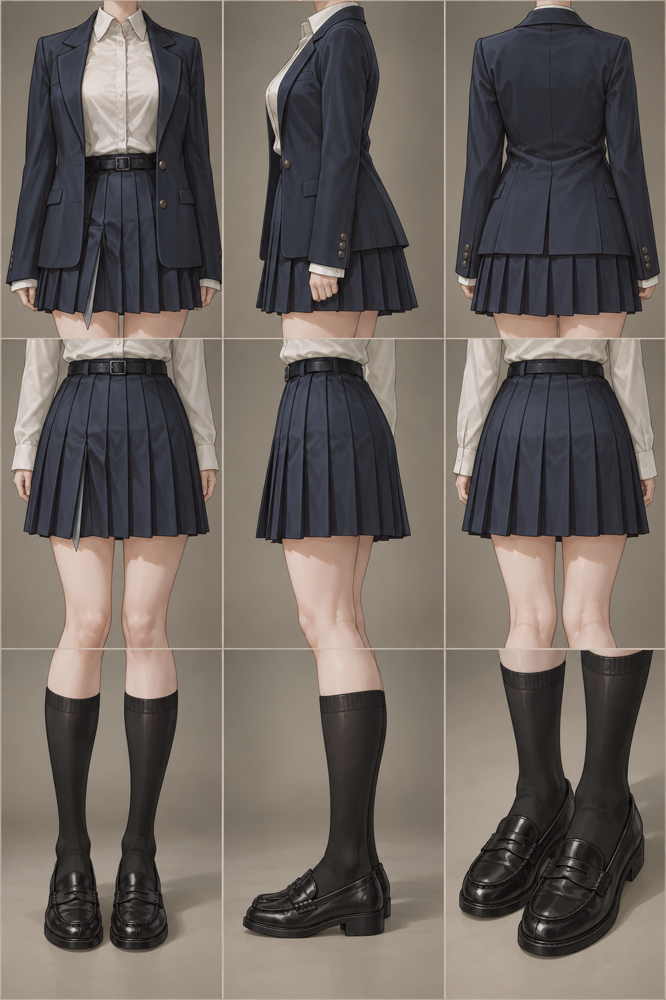

# 藏青西装制服套装

[返回总目录](../README.md)

藏青西装、白衬衫、藏青百褶裙、黑色及膝袜与黑色制服皮鞋。不同区域沿用同一套服装设计与人物比例。

## 人物锚点

[查看人物锚点总览](人物锚点/人物锚点总览.png)

上排依次为长发、马尾、双马尾、短发全身背侧视图；下排为通用与长发版的三种体型上装参考。当前为一张十格合图，尚未作为十张独立锚点交付。

## 服装区域特写

[查看服装区域九宫格](套装总览/服装区域九宫格.png)

| 位置 | 内容 |
| --- | --- |
| 第一排 | 藏青西装：正面、侧面、背面 |
| 第二排 | 藏青百褶裙：正面、侧面、背面 |
| 第三排 | 黑色及膝袜配皮鞋：正面、侧面；制服小皮鞋：四分之三侧面 |

当前为一张九宫格合图。独立正面、侧面、背面素材待逐张制作；此图不计为九张独立素材。
