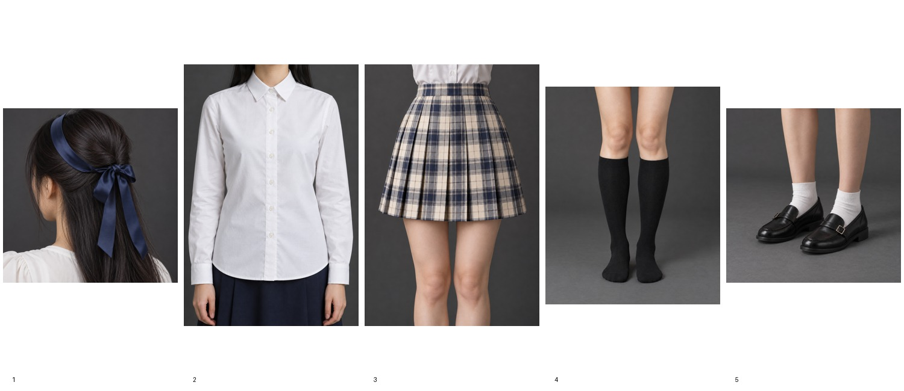
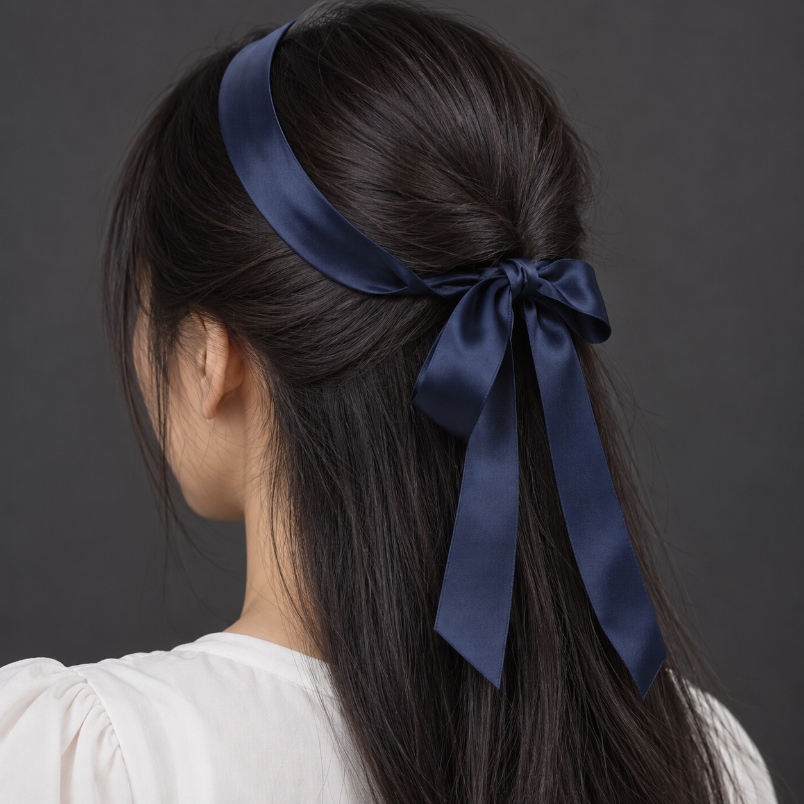
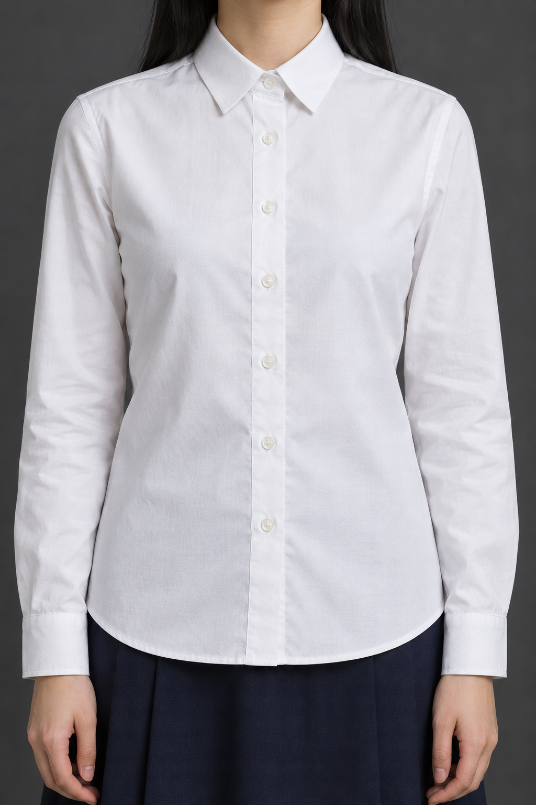
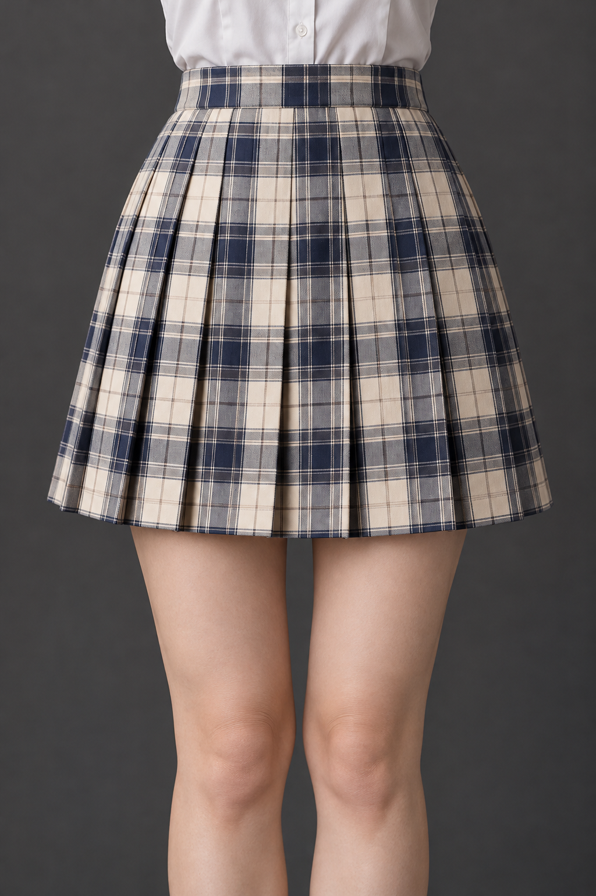
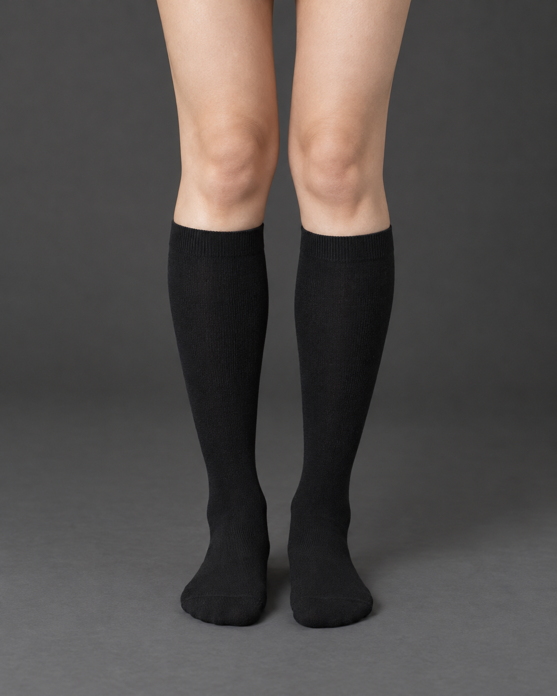
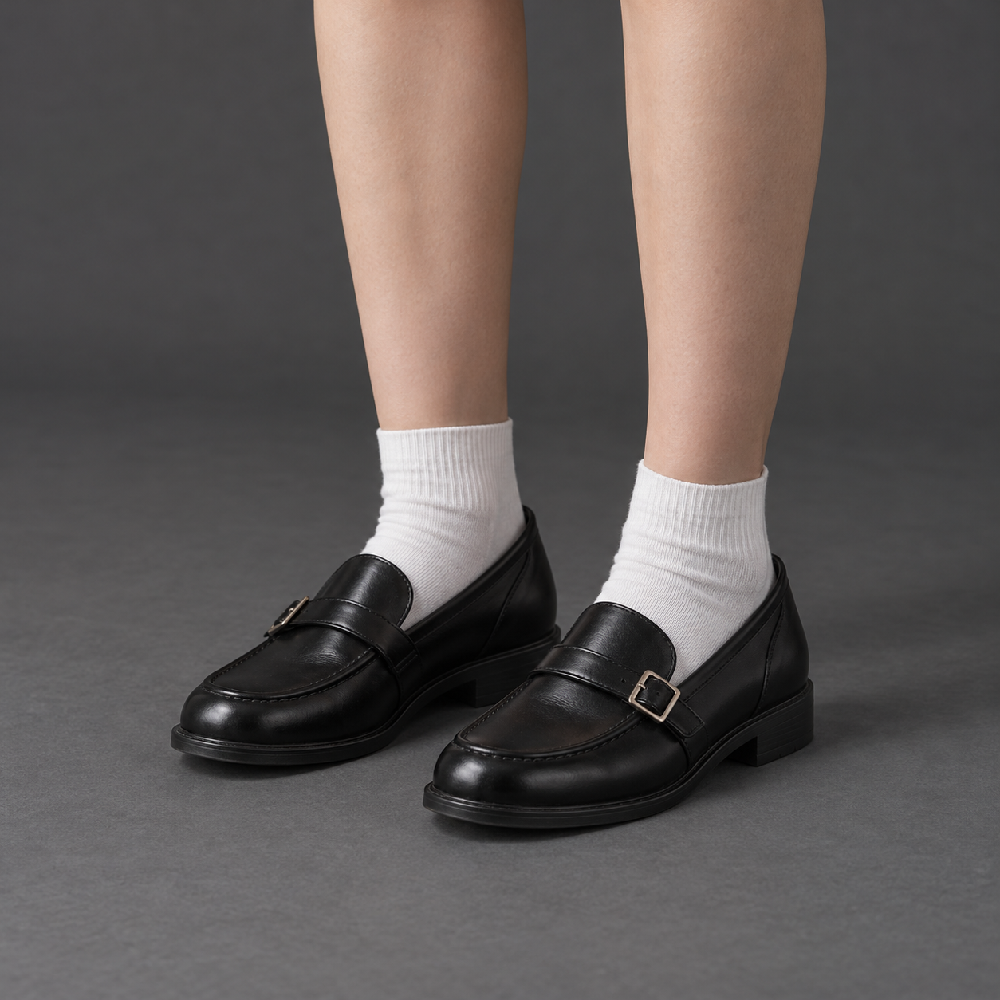

# 服装特写例图

五类各一张，供确认风格；尚未批量生成全套。

## 总览

## 藏青发带·侧面

[查看原图](head_ribbon_navy-side.png)

## 白衬衫·正面

[查看原图](top_jk_shirt-front.png)

## 格纹百褶裙·正面

[查看原图](bottom_jk_pleat_plaid-front.png)

## 黑色及膝袜·正面

[查看原图](sock_knee_black-front.png)

## 制服小皮鞋·四分之三视角

[查看原图](shoe_leather-three-quarter.png)
