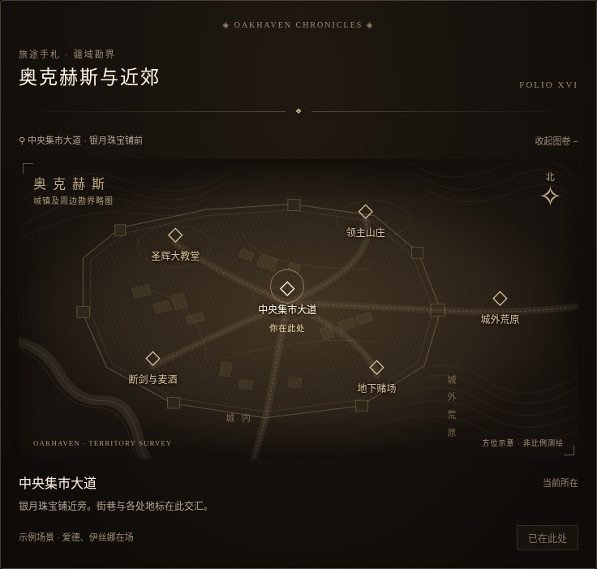

# 奥克赫斯 · 黑金手札地图预览

直接查看下面的地图截图：

## 交互预览

下载 [map-preview.html](map-preview.html)，保存到本地后用浏览器打开。GitHub 文件页面会显示 HTML 源码，不会直接运行页面。

- 点击六个地点，查看地点说明与路线示意。
- 点击“准备前往”，生成可编辑的行动草稿；不会发送消息或修改游戏位置。
- 点击“收起图卷”，折叠或展开地图。

## 文件

- `map-preview.jpg`：静态预览截图，GitHub 可直接显示。
- `map-preview.html`：可独立打开的交互预览。
- `map-source.fragment.html`：用于继续调整的原始预览片段。

本版依据用户提供的《预览_状态栏样式.html》统一黑金配色、字体方向、细金线与原位展开布局。地图方位和路线仅为排版示意；场景人物为示例，未连接酒馆后台。本目录是独立预览，不替换角色卡与运行脚本。
