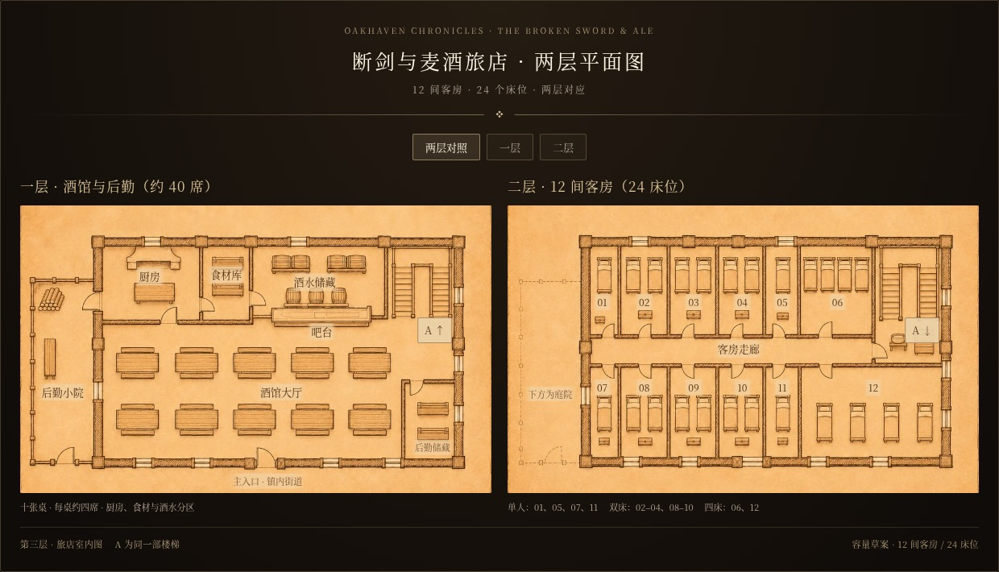

# 奥克赫斯地图

## 第三层：旅店两层平面图

[旅店室内图目录](室内图/断剑与麦酒旅店) · [查看一层](室内图/断剑与麦酒旅店/ground-floor.jpg) · [查看二层](室内图/断剑与麦酒旅店/upper-floor.jpg) · [下载切层预览](室内图/断剑与麦酒旅店/preview.html)

旅店扩容草案为 **12 间客房、24 个床位，一层约 40 席**，并配厨房、食材库、吧台与后勤区。两层主体和楼梯 A 对应；桌面并排查看，手机默认切层显示。容量、房型和具体尺寸仍待定稿。

## 第二层：镇内街区图

[镇内图目录](镇内图) · [镇内图预览](镇内图/preview.html)

展开城墙、三个城门、主街、建筑地块，以及教堂、旅店、练武场、集市、赌场地面入口与珠宝铺。保留院落、菜圃和未标注地块，庄园不在镇内。

## 第一层：全域图

[全域图目录](全域图) · [全域图预览](全域图/preview.html)

西北山上庄园、东北树林、环镇农耕带、西南峡口险道与略宽河面；东南兽人营地处于恶劣荒地，不与人类道路相连。

## 制作状态

- **全域图**：已有草案。
- **镇内图**：已有草案，三门方位与上级地图对应。
- **室内图**：旅店两层已有扩容草案；教堂、赌场等尚待绘制。

[地图规范](MAP_DESIGN.md) · [室内图目录](室内图)

三层共用古朴羊皮纸、细墨线、克制排线与淡彩风格。具体尺寸尚未定稿，不标数字比例尺。

根目录原有 `map-preview.jpg` 等文件保留为早期风格参考，其中镇内庄园布局已经作废。当前地图未连接酒馆后台，不修改角色卡或运行脚本。
