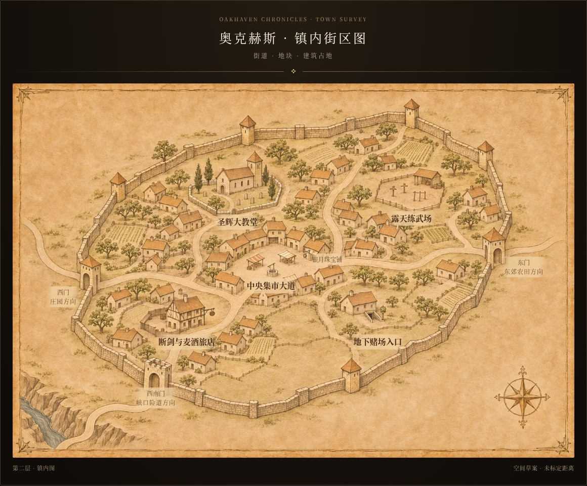

# 奥克赫斯地图

## 第二层：镇内街区图

[查看镇内图目录](镇内图) · [下载镇内图预览](镇内图/preview.html)

展开城墙、三个城门、主街、建筑地块，以及教堂、旅店、练武场、集市、赌场地面入口与珠宝铺。保留院落、菜圃和未标注地块，庄园不在镇内。

## 第一层：全域图

[查看全域图目录](全域图) · [下载全域图预览](全域图/preview.html)

全域图保留已修订的地形关系：西北山上庄园、东北树林、环镇农耕带、西南峡口险道与略宽河面；东南兽人营地处于恶劣荒地，不与人类道路相连。

## 三层制作状态

- **全域图**：已有空间草案。
- **镇内图**：本轮已绘制，三门方位与上级地图对应。
- **室内图**：待绘制，旅馆、教堂、赌场等按建筑分别展开。

[地图规范](MAP_DESIGN.md)

两层地图共用古朴羊皮纸、细墨线、克制排线与淡彩风格。建筑不因重要程度而任意放大，并保留合理的未标注空间。各处精确尺寸尚未定稿，不标数字比例尺。

## 旧风格参考

根目录原有 `map-preview.jpg`、`map-art.webp`、`map-preview.html` 和 `map-source.fragment.html` 保留为早期风格参考，其中镇内庄园的旧布局已经作废。

当前文件为独立地图草案，尚未连接酒馆后台，不修改角色卡或运行脚本。
