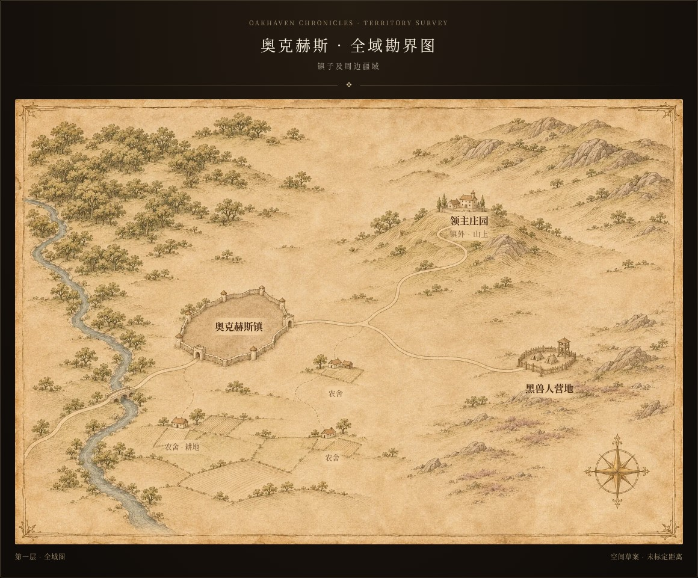

# 奥克赫斯地图

## 第三层：旅店场景导览与房间交互

[旅店导览目录](室内图/断剑与麦酒旅店) · [完整行动填入效果](室内图/断剑与麦酒旅店/interaction-preview.jpg) · [手机效果](室内图/断剑与麦酒旅店/mobile-rooms-preview.jpg) · [下载可点击预览](室内图/断剑与麦酒旅店/interactive-preview.html)

两层单独切换。二层以“点房门 → 展开房间与角色 → 选择行动填入输入框”为主交互；外出角色显示去向，未知状态保持待确认。桌面用门旁姓名牌，手机用图下姓名入口。

入住分配与动向目前为演示数据；场景图不计数旅店全部房间或床位。没有改动角色卡后台。

## 第二层：镇内街区图

[镇内图目录](镇内图) · [镇内图预览](镇内图/preview.html)

展开城墙、三个城门、主街、建筑地块，以及教堂、旅店、练武场、集市、赌场地面入口与珠宝铺。保留院落、菜圃和未标注地块，庄园不在镇内。

## 第一层：全域图

[全域图目录](全域图) · [全域图预览](全域图/preview.html)

西北山上庄园、东北树林、环镇农耕带、西南峡口险道与略宽河面；东南兽人营地处于恶劣荒地，不与人类道路相连。

[地图规范](MAP_DESIGN.md) · [室内图目录](室内图)

三层共用古朴羊皮纸、细墨线、克制排线与淡彩风格。具体尺寸尚未定稿，不标数字比例尺。当前地图未连接酒馆后台，不修改角色卡或运行脚本。

根目录原有地图保留为早期风格参考，其中镇内庄园布局已经作废。
