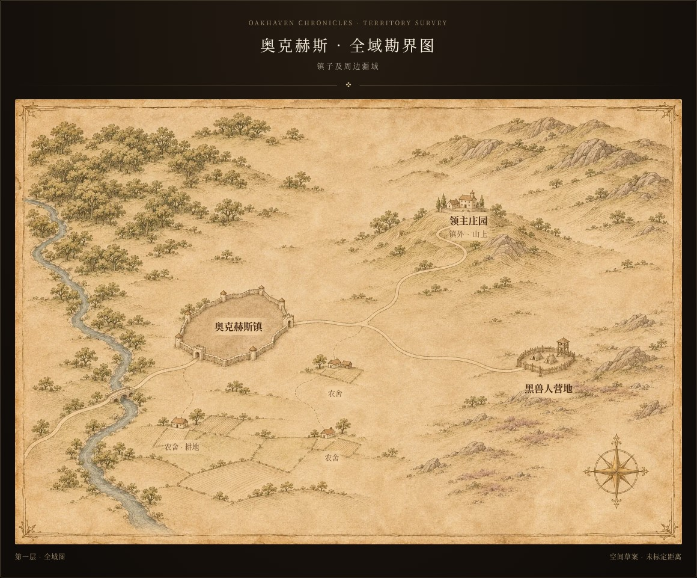

# 第一层：奥克赫斯全域图

[查看无文字底图](regional-art.webp) · [下载独立预览](preview.html)

本图覆盖镇子、周围散户农舍与耕地、镇外山上的领主庄园，以及黑兽人营地。镇子在此层只显示整体边界，不展开内部具体建筑；道路、河流和山地用于表达周边关系。

本轮先以东北山上庄园、东南营地、西侧河流与镇外农田的空间草案落图。方向、距离与各处占地尚待确认，没有标注数字比例尺。

## 文件

- `map-preview.jpg`：已标注地名的截图，GitHub 可直接显示。
- `regional-art.webp`：无文字底图。
- `preview.html`：图片已内嵌，下载一个文件后即可用浏览器打开。
- `map-source.html`：可编辑的原始页面，底图相对路径为 `regional-art.webp`。

地图沿用已确认的古朴羊皮纸、细墨线与克制淡彩风格。底图由 AI 生成，文字独立叠加。

下一层为镇内图，镇子边界、朝向与出入口需要与本图对应；室内图在对应建筑下继续展开。
