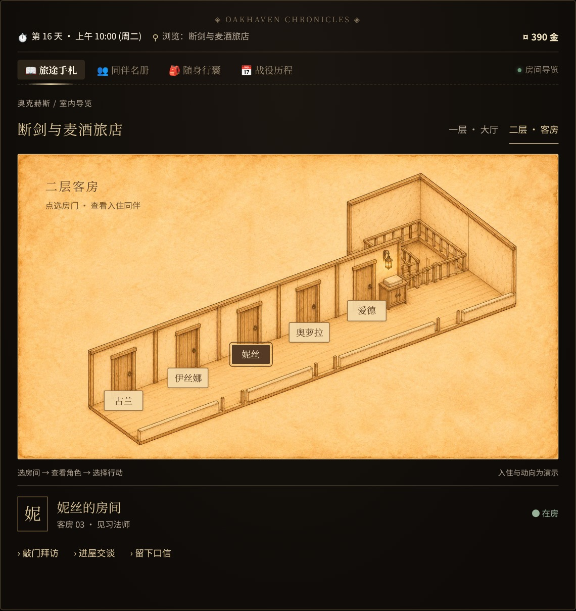

# 断剑与麦酒旅店 · 场景导览与队友房间

[完整行动填入效果](interaction-preview.jpg) · [手机效果](mobile-rooms-preview.jpg) · [二层无标注图稿](upper-scene.jpg) · [下载可点击预览](interactive-preview.html) · [返回镇内图](../../镇内图)

下载 `interactive-preview.html`，用浏览器打开即可体验；图片已内嵌，单文件可用。GitHub 页面上的图片是截图，HTML 源码页面不会直接运行交互。

## 如何交互

1. 切换一层大厅或二层客房；同一时间只显示一个楼层。
2. 二层点房门旁姓名牌，图下展开房间、入住角色与是否在房。
3. 选定具体行动，才把自然语言行动填入输入框，保留已有草稿，可编辑后发送。预览不会自动发送。

在房时提供敲门拜访、进屋交谈和留言；外出时显示去向，并提供前往寻找或留言；不确定在房时先敲门询问。房间归属与人物动向分开，外出后仍能找到其房门。

手机使用图下姓名入口，图内房号对应门的位置；姓名按钮至少 44px，避免缩小后房门热区重叠。地图与图下选中状态同步。

## 画面与数据

两层保持统一平行投影、羊皮纸与细墨线。二层集中呈现走廊、关闭的房门和下行楼梯，不展开床位阵列。门旁姓名、选中状态、房间信息由 HTML 独立叠加，队友换房或外出无需重画图稿。

**入住安排与动向是演示数据，未连接角色卡后台。** 五个展示房门只演示队友房间入口，不代表旅店全部容量；房号不作为后台地点 ID。原角色卡与运行脚本没有改动。

## 接入方式

- `room-guide-component.html` 是可嵌入状态栏的组件片段，图片使用同目录的 `ground-scene.webp` 和 `upper-scene.webp`。
- 组件默认不分配任何角色，也不推断是否在房。预览中的示例在独立的 `inn-preview-fixture` 脚本内。
- 用 `window.okhInnGuide.setState({rooms:[...]})` 整体更新房间数据；每项含 `id`、`occupant: {id,name,role}`、`presence` 与可选 `location`。
- 当前图面房门键为 `door1`–`door5`，仅是图上锚点。须由角色卡接入层映射到真实房间归属，不从角色姓名或“人在旅店”推断其所在房间。
- `presence` 为 `inside`、`away` 或 `unknown`。缺失信息显示待确认，更新时清除旧动作。
- `setFloor('ground'|'upper')` 切层，`selectRoom('door3')` 选择房间。上述操作不发消息或改游戏位置。
- 行动写入本页或同源父页的酒馆输入框；无可用输入框时，保留为可复制的草稿。

示例：`okhInnGuide.setState({rooms:[{id:'door3',occupant:{id:'nise',name:'妮丝',role:'见习法师'},presence:'inside'}]})`。这是接口示例，不是当前游戏状态。

检查：楼层切换、房间选择与输入分离、在房/外出/未知行动、状态变化清除旧动作、已有草稿保留、无输入框时保留可复制行动，以及 390px 手机排版和触控目标均通过。

## 文件

- `rooms-preview.jpg`：原状态栏中的二层房门与选中角色效果。
- `interaction-preview.jpg`：选择行动后填入输入框的完整截图。
- `mobile-rooms-preview.jpg`：手机效果。
- `interactive-preview.html`：单文件可点击演示。
- `room-guide-component.html`：独立地图组件。
- `upper-scene.jpg`、`upper-scene.webp`：二层图稿。
- `ground-scene.jpg`、`ground-scene.webp`：一层图稿。

历史平面与容量讨论

旧建议为 12 间客房、24 床位及一层约 40 席，均未定稿。床位过于突出、俯视建筑平面不适合角色卡内嵌，因此历史图只作结构和容量讨论参考。

[旧两层平面](map-preview.jpg) · [旧一层平面](ground-floor.jpg) · [旧二层平面](upper-floor.jpg) · [旧切层页面](preview.html)

