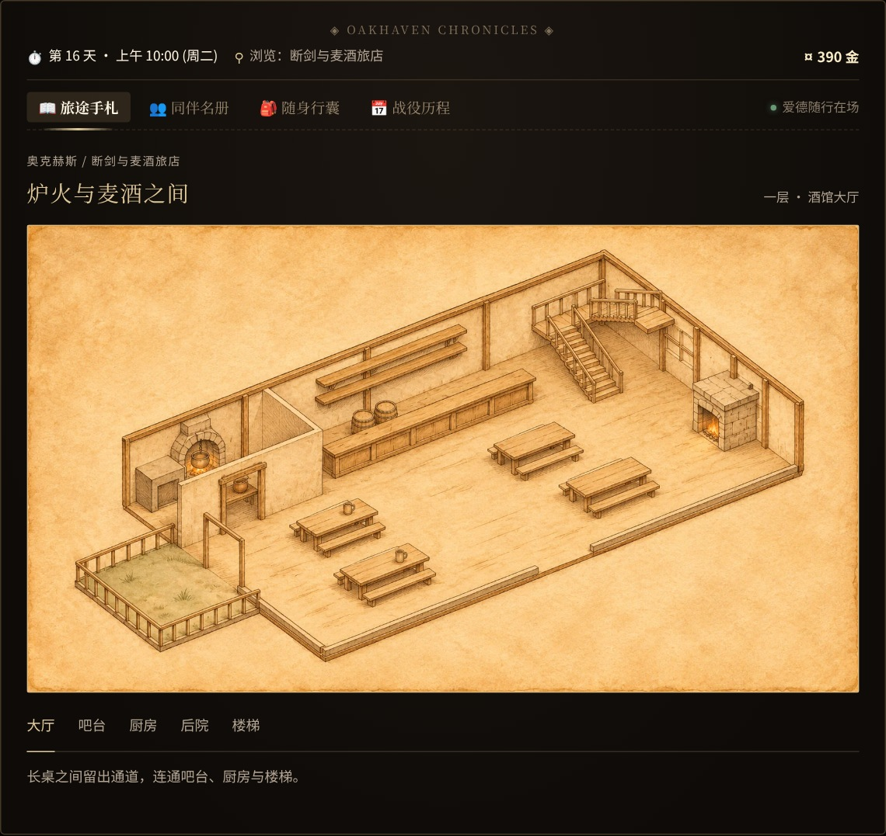

# 断剑与麦酒旅店 · 场景导览草图

[直接查看一层图稿](ground-scene.jpg) · [下载内嵌状态栏预览](scene-embedded-preview.html) · [下载独立导览预览](scene-preview.html) · [返回镇内图](../../镇内图)

## 当前版本

按用户选择改为“单层斜俯视场景，切换楼层”。本轮先修正一层的投影关系；二层将沿用相同视角重画，当前预览不混入旧版二层。

先用同一正交相机建立墙体、楼板、桌椅和折返楼梯，再将结构参考转绘成羊皮纸墨线图。前侧墙体统一切低，以展示内部动线；西侧服务院落通过侧门与大厅连接。大厅、吧台、厨房与楼梯保留清楚的相对关系，减少重复器物与装饰。

预览沿用用户上传的 760px 状态栏外壳、柔金文字和细分隔线。区域按钮只切换说明；不改变玩家位置或发送指令。为集中查看地图，内嵌预览隐藏委托正文等周边内容，原角色卡文件没有被修改。

## 文件

- `ground-scene.jpg`：本轮无文字一层图稿，可在 GitHub 直接查看。
- `ground-scene.webp`：组件使用的压缩图稿。
- `scene-preview.jpg`：嵌入原状态栏后的截图。
- `scene-embedded-preview.html`：图片内嵌的原状态栏预览，下载后用浏览器打开。
- `scene-preview.html`：图片内嵌的独立导览预览。
- `scene-component.html`：地图组件片段，图片相对路径为 `ground-scene.webp`。
- `geometry-reference.py`：生成统一投影结构底稿的 Blender 脚本；仅为绘图结构依据，不是定稿建筑尺寸。

检查：760px 状态栏与 390px 手机宽度下无横向溢出；区域说明切换及选中状态正常，无脚本异常。图稿为 AI 转绘，当前仍是待审阅的空间草图。

历史两层平面与容量讨论

旧方案建议 12 间客房、24 床位与一层约 40 席，尚未经用户定稿。用户随后指出床位过于显眼、俯视建筑平面不适合角色卡内嵌，因此旧方案只作结构和容量讨论参考，不作为当前视觉方向。场景中的桌椅和门不对应逐一计数的接待容量。

[旧两层平面](map-preview.jpg) · [旧一层平面](ground-floor.jpg) · [旧二层平面](upper-floor.jpg) · [旧切层页面](preview.html)

