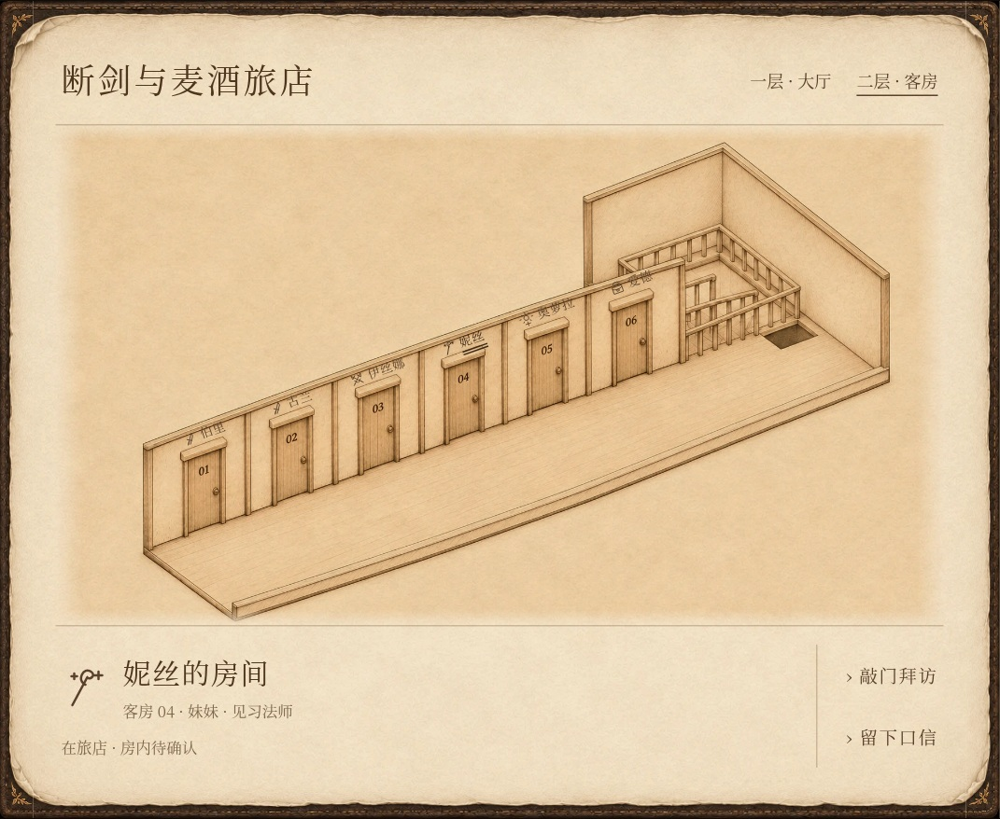

# 正式状态栏 · 旅店手札接入

[一层大厅](inn-ground.jpg) · [手机旅店](inn-mobile.jpg) · [完整状态栏](hud-rooms-desktop.jpg) · [手机状态栏](hud-rooms-mobile.jpg) · [全域图](hud-regional.jpg) · [玩家房间](hud-player-room.jpg) · [行动填入](hud-action.jpg)

[下载可交互预览](hud-live-preview.html) · [正式自动启动脚本](../../dist/okh_complete_autostart.js?raw=1)

旅店已采用可伸缩的皮革装订纸页，一、二层使用同一套淡墨图稿。六个小姓名和单色职业符号位于对应门楣，人物与行动批注在同一纸面。姓名、职业和状态都是独立交互层，未烘焙进底图。手机保留门楣标注，并提供至少 44px 的姓名入口。

下载 `hud-live-preview.html` 后用浏览器打开。此页面执行正式运行库，使用独立沙盒存档；正式状态栏读取相同的存档接口和输入事件。

可切换全域、镇内、旅店一层与二层；点木门展开人物后选择行动，保留已有草稿，不自动发送。页面底部“妮丝外出 / 返回旅店”用于观察沙盒存档变化。正式运行脚本不包含演示按钮或示例存档。

实际接入点在 `src/app/okh_app_map.js`、`src/app/okh_app_hud.js`。正式脚本沿用当前聊天存档，默认挂载在最新助手消息下，兼容同源助手 iframe。

人在旅店显示“房内待确认”；夜间同住仍读取既有 playerRoomTarget 条件，未登场住客与未知去向保留隐藏。古兰为独立住客，玩家有自己的房间。

验证通过：基础回归 28/28、核心回归 16/16、地图回归 10/10、浏览器边界回归 7/7；浏览器检查六扇木门命中、房间与行动、存档刷新、原分页、旧消息简版、iframe，以及 320/390/640px 排版和图片加载失败回退。尚未在用户实际酒馆中导入。

本轮边界自检与复现步骤见 [代码自检记录](../../代码自检_2026-11-20.md)。
