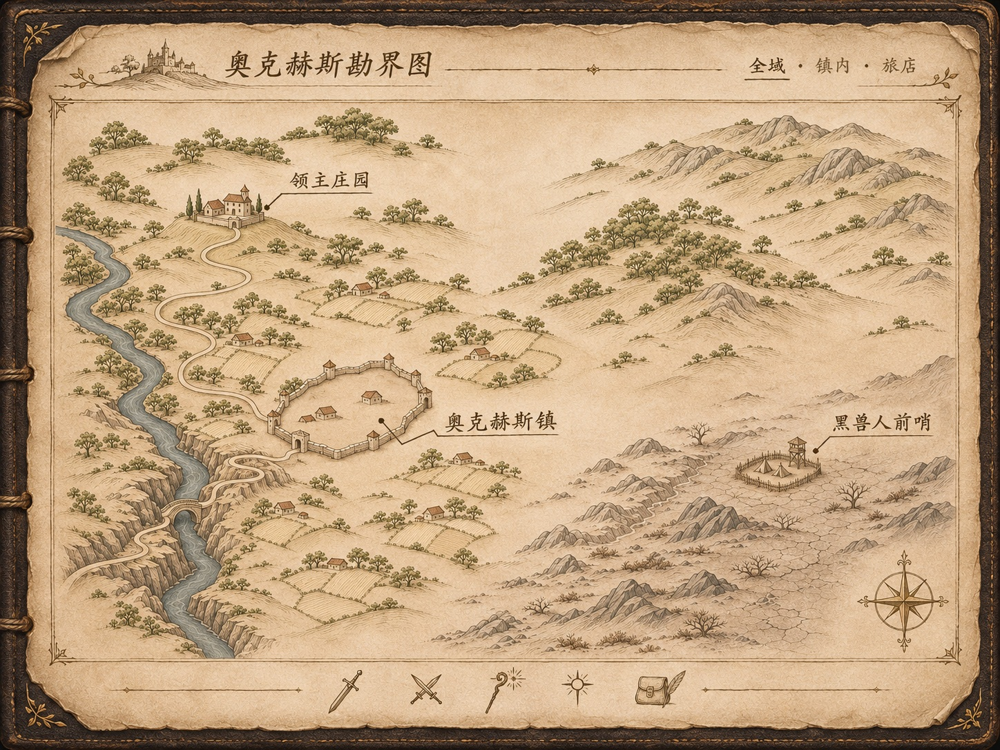

# 地图界面 · 整体美术方向稿

本稿对应用户对“整体美术风格”的修正：统一地图、题注、职业符号、边饰与界面材料，不再只修改字体或方框。

- 沿用已认可的古朴西幻羊皮纸方向，调整为较克制的纸色与棕墨线。
- 地名使用与地图同源的题注、引线与落点，依地图空白组织。
- 职业符号改为相同笔触的墨绘图形，减少金属质感与徽章外框。
- 标题、层级导航与地图作为一张完整手札设计。
- 保留已确认地理：西北山上庄园、东北树林、环镇农耕、河谷险道、东南恶劣荒地上的敌对前哨，前哨不接人类道路。

这是整体美术方向图，尚未转换为可交互界面，也没有替换正式运行脚本。图中文字和符号目前属于图稿，后续功能实现仍需保留独立交互层与真实存档数据。

图稿由 AI 生成，用于整体美术审阅。
