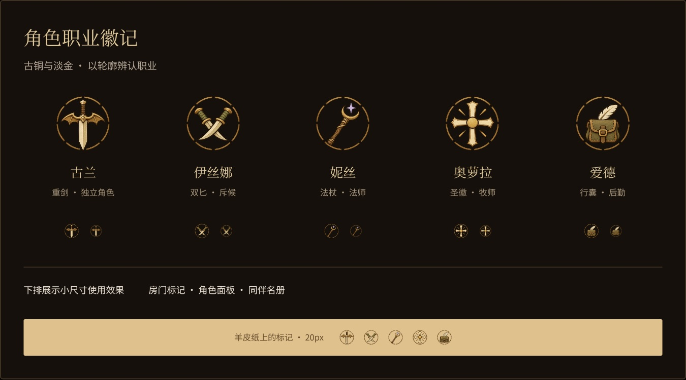

# 角色职业徽记

[透明 PNG 图集](class-icons.png) · [透明 WebP 图集](class-icons.webp) · [放入状态栏的效果](../室内图/断剑与麦酒旅店/rooms-preview.jpg) · [手机效果](../室内图/断剑与麦酒旅店/mobile-rooms-preview.jpg)

| 队友 | 职业标记 | 图标键 |
| --- | --- | --- |
| 古兰 | 重剑（独立角色） | `warrior` |
| 伊丝娜 | 交叉双匕 | `scout` |
| 妮丝 | 星月法杖 | `mage` |
| 奥萝拉 | 放射圣徽 | `cleric` |
| 爱德 | 羽笔与行囊 | `support` |

五枚共用古铜、淡金、深褐描线与断环外框，依靠轮廓区分职业。图集背景透明，可叠放于深棕状态栏和羊皮纸地图。总览中的下排展示 20px 与 16px 大小；地图标记约 20px、姓名旁 16–18px、角色面板 32px，使用同一套图标。职业图标旁保留姓名，未来同职业角色不会仅靠图形区分。

古兰是女性独立角色，不属于冒险者小队；她的重剑徽记只表示其战斗形象，不赋予领队或队员身份。

## 资源使用

`class-icons.png` 与 `class-icons.webp` 为原始完整图集，2172 × 724；五枚从左至右等宽排列。没有把姓名烘焙进图片。

`class-icons.css` 提供 CSS 图集显示，不需要裁切原图。图标区域为每个横向单元中央的正方形，背景尺寸为 500% × 166.666667%，五个横向位置为 0%、25%、50%、75%、100%。

示例：`<i class="okh-class-icon" data-class="mage" aria-hidden="true"></i>妮丝`。默认 20px，可用 `--class-icon-size` 调整。

旅店组件使用 `occupant.classId` 指定职业键，姓名、职业和房间归属独立。未设置或不认识的职业键保留文字回退，不把角色错误归类。

这是角色卡美术与交互预览资源，尚未替换正式角色卡或接入后台。图稿由 AI 生成。
